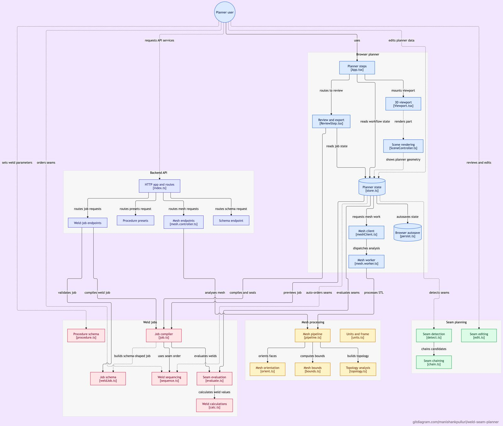
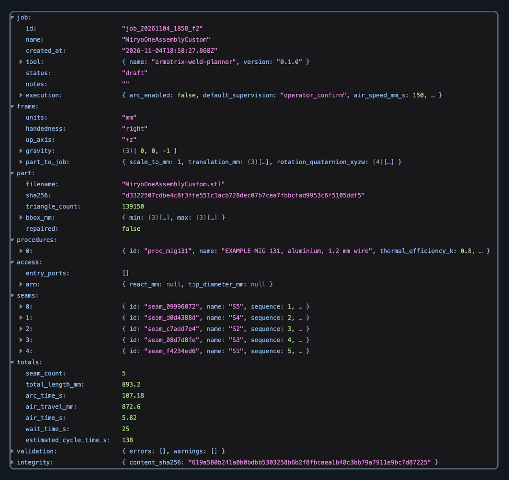
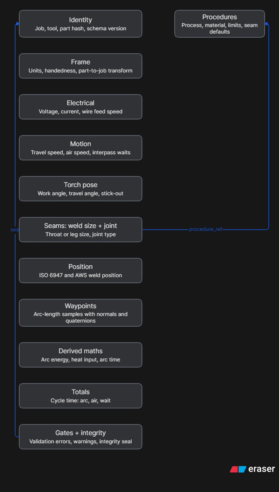

<div align="center">
  <h1>Weld Seam Planner</h1>
  <p><strong>Upload an STL. Pick the seams. Tune the weld. Export a robot-ready job.</strong></p>
  <p>
    
    
    
    
    
    
  </p>
  <p>
    <a href="#tech-stack">Stack</a> ·
    <a href="#3-architecture">Plan</a> ·
    <a href="#5-end-to-end-walkthrough-the-five-steps">The five steps</a> ·
    <a href="#7-export-format-weldjobjson-schema-100">Export format</a> ·
    <a href="#8-run-it-locally">Run it</a>
  </p>
</div>

> Mesh processing runs in your browser; the part never leaves your machine. Every number downstream of your picks is computed, never typed, and the export is sealed with a SHA-256 integrity hash.

---

## Tech stack

| Layer | What | Details |
|---|---|---|
| Runtime | Bun 1.3+ | Only toolchain needed: install, dev, test, build |
| Language | TypeScript 5 | Strict, typechecked with `bun run check` |
| Frontend | React + Vite + Zustand | 5-step wizard, top-bar project switcher, View-Transition themes |
| 3D | Three.js | SceneController viewport: seams, torch glyph, air moves, section plane, X-ray |
| Concurrency | Web Worker | All mesh work off the UI thread; staged progress |
| Backend | Bun + Hono | One process: serves the SPA statically plus the JSON API |
| Shared core | `@weld/core` | Dependency-free TS: mesh, seams, weld maths, sequence, Zod schema |
| Schema | Zod (source of truth) | `backend/schema/weld-job.schema.json` generated, never hand-edited |
| Persist | IndexedDB + localStorage | Autosave, up to 5 named projects per browser |
| Ship | Docker, single image | `manishank/weld-planner:v1`, one process on port 8000 |

---

## Contents

| Section | What's inside |
|---|---|
| [1. The problem we started from](#1-the-problem-we-started-from) | Why hand-built weld plans fail, and what this replaces |
| [2. How we solved it](#2-how-we-solved-it) | The five-step idea plus the three principles holding it up |
| [3. Architecture](#3-architecture) | Diagram, endpoints, and the decisions behind them |
| [4. How a part becomes a plan](#4-how-a-part-becomes-a-plan-in-plain-words) | The pipeline in plain words, one short stage at a time |
| [5. End-to-end walkthrough](#5-end-to-end-walkthrough-the-five-steps) | What you actually click, step by step |
| [6. Features built](#6-features-built) | Everything the app can do today |
| [7. Export format](#7-export-format-weldjobjson-schema-100) | Structure diagram plus real sample JSON, side by side |
| [8. Run it locally](#8-run-it-locally) | Dev, Docker, and environment variables |
| [9. Limits](#9-limits) | Honest boundaries |
| [10. Future ideas](#10-future-ideas) | What comes next and how it would fit |

---

## 1. The problem we started from

Programming a robotic welding cell starts with a CAD part and ends with a controller that needs exact numbers: where each seam lies on the part, which direction to weld it, how the torch must tilt at every point along it, and the electrical recipe behind each pass. In practice that plan is built by hand: an engineer eyeballs edges in a CAD viewer, types waypoints into a spreadsheet or teach pendant, and hopes the torch angles, heat input and weld positions are consistent. Every hand-copied number is a chance to scrap a part or, worse, to weld with the wrong heat input and only find out at inspection.

The planner closes that gap end to end: from an untrusted STL file to a sealed, validated JSON weld job a robot controller can consume without re-interpretation.

## 2. How we solved it

Five steps mirror how a welding engineer actually works: check the part, pick the seams, set the procedures, order the work, review and export.

Three principles hold the whole product together:

- **Local first.** Parsing, repair, detection and all maths run in a Web Worker in your browser; the backend only serves the app and repeats the same calculations for automation.
- **One shared core.** `@weld/core` is dependency-free TypeScript used identically by the UI and the API, so the browser and the server can never disagree.
- **Guess nothing silently.** STL files carry no units and no material, so the app guesses openly, badges every guess, and blocks progress until you confirm.

## 3. Architecture



| Endpoint | Purpose |
|---|---|
| `GET /api/v1/health` | Liveness |
| `POST /api/v1/mesh/validate`, `/repair` | Server-side mesh check / repair (same core code) |
| `GET /api/v1/schema/weld-job` | JSON Schema of the export |
| `GET /api/v1/procedures/presets` | EXAMPLE procedures |
| `POST /api/v1/weld-jobs/compile` | Build a sealed weld job from seams + settings |
| `POST /api/v1/weld-jobs/validate` | Validate a job against the schema and check its content hash |

**Why one shared core.** `@weld/core` has zero UI or server imports, so the exact same functions run in the browser worker and on the server. The numbers in the panels and the numbers in the API can never disagree, and one geometry suite (8 known weldments, rotated: 100% recall, under 0.01 mm error) guards both.

**Why the Zod schema is the single source of truth.** Every exported field carries a `.describe()` string; the published JSON Schema and the frontend TypeScript types are generated from those descriptions, never hand-written.

**Why local-first guessing.** STL files carry no units and no material, so the app must guess, but a guess that pretends to be fact corrupts every downstream number. The rules are explicit and every guess is badged until you confirm it; confirmation gates steps 2 to 5. The part genuinely never leaves the machine.

**Why stable seam IDs.** IDs derive from a hash of kind plus rounded endpoints and length (centroid plus mean normal for loops), so re-running detection with new thresholds keeps your edits on every unchanged seam. Splits and merges mint new IDs; the undo toast names exactly what changed.

**Why deterministic export.** Sorted keys, lengths rounded to 3 decimals, unit vectors and quaternions to 6, UTC timestamps, then the SHA-256 is computed with the integrity block itself removed. Same plan in means byte-identical file out, which is what makes the hash a real tamper seal and re-import matching by hash trustworthy.

**Why single-level undo plus autosave.** The undo toast names one action and offers one-click revert (bulk accepts included); work autosaves to IndexedDB, and up to 5 named projects live side by side in the top-bar switcher so switching plans can never cross-contaminate them.

**Why one container.** The backend already serves the SPA, so splitting frontend and backend images would only add network hops between a UI and the API it proxies. One image, one process, one port.

## 4. How a part becomes a plan, in plain words

*No algorithm names below on purpose. Ten short stages, in the order they run.*

<details>
<summary><strong>1. Collect the triangles</strong></summary>

An STL file is just a long list of triangles. We read every single one, throw away the stored normals (they are often wrong), and drop zero-area triangles and exact duplicates.

</details>
<details>
<summary><strong>2. Glue the corners together</strong></summary>

A real part has shared corners, but a file stores each triangle's corners separately. So we snap together every corner that lands on essentially the same spot. After this, edges shared by two triangles become visible, and that shared-edge map is the foundation for everything else.

</details>
<details>
<summary><strong>3. Trace the shells</strong></summary>

Walk from edge to edge: in a clean solid, every edge is shared by exactly two triangles, so following them traces out closed shells. Separate bodies trace out as separate shells, which is normal for weldments. An edge with only one triangle is a hole. An edge shared by three or more triangles means plates are touching there, which is itself a weld hint.

</details>
<details>
<summary><strong>4. Turn every face outward</strong></summary>

For a closed shell, start on one face and flood across it, flipping neighbours so all faces point outward; the enclosed-volume check confirms the direction. For open patches, cast rays from the surface and let the hits vote on which way is out.

</details>
<details>
<summary><strong>5. Find the bends</strong></summary>

For every shared edge, measure how sharply its two faces bend. A sharp inward bend roughly between 45 and 120 degrees is a fillet candidate. Two impostors are rejected: rounded edges (many tiny parallel bends close together) and machined cylinders or bores (evenly spaced bends ringing a hole). Places where separate bodies touch or pass through each other become contact and intersection candidates.

</details>
<details>
<summary><strong>6. Link pieces into seams</strong></summary>

Short matching pieces that meet end to end are chained into longer seams, breaking the chain at sharp corners; stubs shorter than a fraction of the part size are dropped. Each seam gets a stable ID, so re-running detection keeps your keep, drop, rename and parameter edits on every seam that did not change.

</details>
<details>
<summary><strong>7. Fix the units once</strong></summary>

The file never states its units, so we assume millimetres and sanity-check the size (a two-millimetre car is probably metres). You confirm, and from then on every number downstream is millimetres, Z up, gravity down.

</details>
<details>
<summary><strong>8. Do the weld maths</strong></summary>

Arc energy comes from volts times amps divided by travel speed; heat input is a fixed efficiency fraction of that (0.8 for MIG/MAG and flux-cored, 0.6 for TIG). Arc time is welded length over speed times passes. Throat and leg convert through the opening angle. Weld position comes from the seam's slope and how its faces rotate against gravity, and is recomputed whenever you reverse a seam.

</details>
<details>
<summary><strong>9. Aim the torch</strong></summary>

At each point the torch looks straight down the corner bisector into the weld, then tilts by your work-angle and travel-angle offsets. The frame is resampled about every 5 mm, and each waypoint stores the point, tangent, face normals, torch axis, contact-tip position and full tool orientation with continuous sign, so a controller never sees a flipped pose mid-seam.

</details>
<details>
<summary><strong>10. Order the work</strong></summary>

Visit the closest unvisited seam next, then untangle crossings with a few passes, flipping a seam's direction when that shortens the trip. Seams are grouped by compartment first, and the plan warns if one side of the part would soak up far more heat than the other.

</details>

## 5. End-to-end walkthrough: the five steps

### Step 1 — Part

Drop in an STL. It is parsed, welded, oriented and health-checked before your eyes: open edges, flipped faces, non-manifold edges, separate bodies, each in plain language. One-click repair fills holes and fixes face orientation with before/after counts and undo. Confirm units and the up axis once; that choice locks the scale and frame every later number depends on.

### Step 2 — Seams

Press **Detect** and the app suggests inside corners, touching plates and intersecting bodies as dashed candidates. **Review one by one** frames each suggestion while you press **K** (keep) or **D** (drop); the seam list also takes bulk accept/reject with undo. Missed one? **Pick edge** grabs a whole tangent-continuous edge chain on hover, and **Draw** traces freehand over the surface with snapping. Then rename, reverse, split (click a point or split into equal parts, with live preview), merge touching seams, or delete. A **section plane** plus **Work here only** confines all of this to one side of a cut; **X-ray** reveals internal seams; the body list and focus mode isolate what you are working on.

> Candidate and ops cards float beside the panel at your click point and vanish the moment you pick another seam or leave the step.

### Step 3 — Procedures

A library of weld recipes: EXAMPLE MAG 135 (steel), MIG 131 (aluminium), FCAW 136 (steel), TIG 141 (stainless) to start, plus your own custom cards with base metal and thickness. Apply one procedure to many seams at once, then override anything per seam: weld size (throat `a` or leg `z`), passes, stitch length and pitch, its own current, voltage and travel speed, torch angles, stick-out, approach and retract, crater fill, position. Heat input, arc time and position recompute live with plain-language warnings when you leave the WPS window.

### Step 4 — Sequence

Drag rows (or keyboard) into weld order, flip any seam's direction, set cooling waits, tune air speed — or hit **Auto order** and let nearest-neighbour plus crossing-untangling passes do it, flipping directions to cut air travel and reporting millimetres saved. The part itself shows sequence numbers, direction arrows and dashed air moves; totals accumulate arc time, air travel, waits and cycle time. **▶ Play weld** then runs a torch glyph along every seam in order at real travel speed, lighting up each seam as it completes.

### Step 5 — Review

Name the job, set draft (arc off) or approved (arc on), pick supervision. Validation gates the export: errors block it, warnings travel with it, and every issue jumps straight to its seam. Preview the JSON, download or copy it, and re-import it onto the same part later to restore everything.

*Across all steps: a five-dot number-line stepper with keyboard shortcuts (`1`–`5`, `F`, `R`, `W`, `X`, `E`/`D`, `A`, `V`, `?` overlay), single-level undo with a named toast plus redo, dark and light studio themes with an animated theme toggle, animated confirmations instead of native dialogs, autosave plus up to 5 named projects in the top-bar switcher, and per-step “How this step works” guides.*

## 6. Features built

- **Part:** drop STL (binary/ASCII, chunked upload), staged progress, health card, optional repair with undo + repaired-STL download, units/up-axis confirmation gating the rest.
- **Seams:** auto-detect with tunable angle/length/tolerance, review-one-by-one (K/D), bulk accept/reject with undo, pick-edge and draw tools, rename/reverse/split/merge/delete, duplicate suppression, section plane with work-here-only, X-ray, body show/hide/isolate, focus mode, floating candidate and ops cards.
- **Procedures:** EXAMPLE library (MAG 135, MIG 131, FCAW 136, TIG 141) plus custom cards with base metal and thickness, bulk assign with “apply to the ones without one”, per-seam overrides with reset, live heat input/arc time/position and plain-language warnings (fill-rate, multipass, spray, FCAW push, and more).
- **Sequence:** drag/keyboard reorder, per-seam direction flip, waits, air speed, auto-order with millimetres-saved readout, on-part numbers/arrows/air moves, totals, ▶ Play weld at real speed with scrubber.
- **Review:** job metadata and status, validation gating with jump-to-issue, collapsible JSON preview, download/copy, `.weldjob.json` re-import (SHA-matched, with a guided restore banner).
- **Everywhere:** number-line stepper, full keyboard map, undo/redo, light/dark studio themes, animated View-Transition theme toggle, animated confirms, 5-slot project switcher with localStorage/IndexedDB persistence, collapsible “How this step works” guides.

## 7. Export format (`.weldjob.json`, schema 1.0.0)

Millimetres throughout (`*_mm`), one right-handed Z-up frame, UTC timestamps, `seams[]` in execution order. The machine-readable contract is `backend/schema/weld-job.schema.json` (generated, never hand-edited).





The numbers tie together: `proc_mig131` runs 21 V × 170 A at 500 mm/min, so arc energy is 0.4284 kJ/mm and heat input is 0.8 × that = 0.343 kJ/mm, inside the procedure's 0.3–1.0 WPS window. Each seam points at its recipe with `procedure_ref`, and `effective` carries the resolved values the robot uses.


## 8. Run it locally

Requires [Bun](https://bun.sh) 1.3 or newer. No other toolchain is needed.

```bash
bun install          # install all workspaces (root, core, backend, frontend)
bun run dev          # frontend on http://localhost:5173, API on http://localhost:8000
bun run test         # core, frontend and backend test suites
bun run check        # TypeScript typecheck across all workspaces
bun run build        # production frontend build (served by the backend)
```

Docker (single self-contained image — backend plus the built SPA in one process):

```bash
# Local setup (pull the frozen release, start it)
docker pull manishank/weld-planner:v1
docker compose up -d
# app on http://localhost:8000, health at http://localhost:8000/api/v1/health

# Or without compose
docker run --rm --name weld -p 8000:8000 -e MAX_FILE_MB=500 manishank/weld-planner:v1
```

Or deploy as is with `fly deploy` (configuration lives in `fly.toml`).

Environment variables (all optional except as noted):

| Variable | Default | Meaning |
|---|---|---|
| `PORT` | `8000` | Port the Bun server listens on |
| `MAX_FILE_MB` | `500` | Largest accepted STL upload |
| `UPLOAD_DIR` | OS tmp `weld-uploads` | Chunked-upload scratch directory |
| `UPLOAD_TTL_MIN` | `30` | How long incomplete uploads are kept |
| `STATIC_DIR` | `backend/src/../../frontend/dist` | Where the built SPA is served from |
| `CORS_ORIGIN` | empty (same-origin only) | Allowed browser origins for `/api/*` |
| `VITE_API_URL` | `http://localhost:8000` | API origin baked into the dev client (see `frontend/.env.example`; never put secrets in `VITE_*` variables) |

## 9. Limits

- EXAMPLE procedures are starting points, not recommendations. Always substitute your WPS values.
- Weld position is evaluated from the middle of each seam; curved or strongly sloping seams may need a manual override.
- Torch clearance is not checked yet (`access.status: not_checked`) and air moves are straight lines, so verify reach and collisions in the cell.
- Base metal is declared per procedure, not detected: STL files carry no material information, so the app trusts your selection (with conventional defaults per process).
- Work autosaves in this browser (IndexedDB, up to 5 projects in the top-bar switcher). It is not synced between browsers or machines; loading another part starts fresh in that project.
- The JSON carries no mesh, only the part hash. Re-import strictly requires the same STL file.

## 10. Future ideas

Thoughts under exploration, with how each would likely be implemented:

- **Torch clearance check.** Cast rays from each waypoint along the torch axis (plus a small cone) against a spatial index of the part for the configured torch length; mark `access.status` blocked with the offending waypoint. Fits the existing `access`/`checks` blocks without a schema break.
- **Entry ports and arm reach (Armatrix-specific).** Let the user click openings to place ports (position, direction, diameter) and report per-seam straight-line distance versus configured arm reach, labelled as an estimate. Populates the currently reserved `access.entry_ports` and `access.arm` fields.
- **Distortion-balanced sequencing.** Beyond shortest air travel: order seams to alternate sides of the neutral plane and spread heat (the plan already tracks per-seam heat, so a heat-balance score and a side-imbalance warning are natural next steps).
- **Weld map export.** A CSV/printable summary per seam (name, size, passes, position, procedure) alongside the JSON for the shop floor.
- **Simplified motion primitives.** Detect straight runs and arcs within the dense waypoint list (inside a chord tolerance) and export them as line/arc moves, since dense point streams can cause stop-and-go motion on some controllers.
- **Voxel clearance and free-space air moves.** Upgrade straight-line air moves with a coarse 3D grid that searches cube by cube for a collision-free path for inside-structure work, still labelled as estimates rather than arm kinematics.
